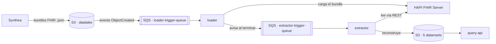

# Synthea FHIR DevOps

Plataforma para la generación, exposición y validación de datos clínicos sintéticos de neurorrehabilitación (Trabajo Fin de Máster, Máster en DevOps de UNIR).

Genera pacientes sintéticos con [Synthea](https://github.com/synthetichealth/synthea), los carga en un servidor [HAPI FHIR](https://hapifhir.io/), construye cinco datamarts analíticos y los expone mediante una API de consulta. Toda la infraestructura se define con Terraform y se despliega en AWS (ECS Fargate); el código se integra y se publica con GitHub Actions.

## Qué está desplegado

Los cuatro servicios se ejecutan de forma persistente en Amazon ECS Fargate y están conectados mediante colas SQS:

| Servicio | Tecnología | Función |
|---|---|---|
| `fhir-server` | HAPI FHIR 7.2.0 (Java, Docker) sobre PostgreSQL en RDS | Almacena los recursos FHIR. En local usa su base de datos H2 por defecto |
| `loader` (fhir-loader) | Python | Escucha `loader-trigger-queue`, descarga cada bundle del datalake y lo carga en HAPI |
| `datamart` (extractor-builder) | Python | Escucha `extractor-trigger-queue`, lee de HAPI y reconstruye los 5 datamarts en S3 |
| `query-api` | Python (Flask) | Sirve los datamarts por HTTP |

Estado verificado de extremo a extremo con 19 pacientes sintéticos: `dm_paciente` 19 filas, `dm_funcional` 237, `dm_episodio` 768, `dm_procedimientos` 18 y `dm_diagnosticos` 15 (estas dos últimas solo contienen códigos de neurorrehabilitación). Los 20 tests pasan: 14 unitarios y 6 de integración contra el HAPI desplegado.

## Arquitectura



El pipeline de carga y extracción es **asíncrono**: subir un bundle nuevo al datalake dispara automáticamente su carga en FHIR, y cada carga completada dispara automáticamente la reconstrucción de los datamarts, sin intervención manual.

AWS Academy bloquea AWS Cloud Map, así que `loader` y `extractor` localizan HAPI consultando a ECS la IP privada de la tarea en ejecución (variables `FHIR_ECS_CLUSTER`, `FHIR_ECS_SERVICE` y `FHIR_PORT`). Esa IP cambia en cada despliegue, por lo que se resuelve en cada uso.

## Estructura del repositorio

```
terraform/              Infraestructura como código (módulos: networking, storage, database, compute; iam desactivado, ver más abajo)
services/
  fhir-server/           Dockerfile de HAPI FHIR (dialecto PostgreSQL, memoria y expunge) y docker-compose
  loader/                Consumidor SQS: carga bundles del datalake en FHIR
  datamart/              Consumidor SQS: extrae de FHIR y construye los 5 datamarts
  query-api/             API que sirve los datamarts ya construidos
  monitoring/            Prometheus + Grafana (solo en local)
  synthea/               Submódulo: generador de pacientes sintéticos
data/sample-fhir/        Lote de ejemplo: hospital, médicos y pacientes sintéticos
deploy/local/            docker-compose.yml para desarrollo local
scripts/                 Scripts de operación (ver "Scripts")
tests/                   Suite de pytest (unit / integration)
.github/workflows/       CI/CD
```

## API de consulta

| Endpoint | Función |
|---|---|
| `/` | Interfaz web de demostración |
| `/health` | Estado del servicio |
| `/api/pacientes` | Listado general de pacientes |
| `/api/pacientes/neurorehab` | Pacientes del dominio de neurorrehabilitación, con sus diagnósticos |
| `/api/pacientes/{patient_id}/resumen` | Resumen clínico de un paciente (agrega los cinco datamarts; 404 si no existe) |
| `/api/escalas` | Escalas funcionales registradas |
| `/api/episodios` | Episodios asistenciales |
| `/api/procedimientos` | Procedimientos terapéuticos |
| `/api/diagnosticos` | Diagnósticos |

La API lee los datamarts de S3 y no consulta HAPI en cada petición.


## Requisitos previos

- [Terraform](https://developer.hashicorp.com/terraform) ≥ 1.9
- Docker (con Docker Compose)
- Python 3.11+
- AWS CLI v2
- PowerShell (los scripts de operación son `.ps1`)
- Una sesión activa de AWS Academy Learner Lab, o una cuenta de AWS propia

## Desarrollo y pruebas en local

### Levantar el entorno local (FHIR + observabilidad)

```
docker compose -f deploy/local/docker-compose.yml up -d
```

Levanta HAPI FHIR (`localhost:8080`), Prometheus (`localhost:9090`) y Grafana (`localhost:3000`). La observabilidad solo está disponible en local.

### Tests

La suite tiene 20 pruebas: 9 en `test_extractor.py`, 5 en `test_query_api.py` y 6 en `test_fhir_integration.py`.

```
pip install -r tests/requirements.txt
pytest tests/ -m unit            # 14 pruebas, no necesitan servicios externos
pytest tests/ -m integration     # 6 pruebas, necesitan un HAPI FHIR con datos
```

Las de integración leen la URL de HAPI de la variable `FHIR_SERVER_URL` (por defecto `http://localhost:8080/fhir`). Para ejecutarlas contra el HAPI desplegado en AWS, que está en una IP privada, usa `scripts/run-integration-tests.ps1`.

### Probar el pipeline asíncrono (SQS) sin gastar créditos de AWS

`scripts/local_pipeline_test.py` simula el datalake, las dos colas SQS y la notificación S3 a SQS con [LocalStack](https://www.localstack.cloud/) (o [moto](https://github.com/getmoto/moto) como alternativa sin Docker, ver la cabecera del script). Permite comprobar de principio a fin que `loader.py` y `extractor.py` reaccionan a los eventos sin tocar AWS.

## Despliegue en AWS

Todos los comandos se ejecutan desde la raíz del repositorio en PowerShell. En AWS Academy hay que repetir el paso 1 al comienzo de cada sesión.

### 1. Credenciales de la sesión

En AWS Academy: *Start Lab*, *AWS Details*, *AWS CLI: Show*. Pega el bloque en `%USERPROFILE%\.aws\credentials` (sustituyendo el contenido anterior) y ejecuta, con el punto inicial:

```
. .\scripts\lab-session.ps1
```

El script carga las credenciales en la ventana actual, comprueba la cuenta, ajusta el `lab_role_arn` de `terraform/terraform.tfvars` y, si tienes el CLI de GitHub (`gh`) iniciado, actualiza los tres secrets `AWS_*` del repositorio. Las credenciales nunca se escriben en ficheros versionados.

### 2. Infraestructura

```
cd terraform
terraform init
terraform plan -refresh=false -out tfplan
terraform apply tfplan
cd ..
```

Requiere un `terraform/terraform.tfvars` local, no versionado, con `db_password`, `vpc_id`, `subnet_ids` y `lab_role_arn` de la sesión activa. Revisa el plan antes de aplicar: no debe destruir ni reemplazar RDS ni los buckets. El estado de Terraform es local (el backend S3 está preparado pero comentado en `terraform/main.tf`).

### 3. Imágenes y servicios

```
$reg = "<cuenta>.dkr.ecr.us-east-1.amazonaws.com"
$token = aws ecr get-login-password --region us-east-1
docker login --username AWS --password $token $reg

docker build -t "$reg/synthea-fhir-dev-fhir-server:latest" services/fhir-server
docker push "$reg/synthea-fhir-dev-fhir-server:latest"
# repetir para loader, datamart (repositorio "extractor") y query-api

aws ecs update-service --cluster synthea-fhir-dev-cluster --service synthea-fhir-dev-fhir-service --force-new-deployment
```

Los repositorios ECR se llaman `synthea-fhir-dev-{fhir-server,loader,extractor,query-api}` y los servicios `synthea-fhir-dev-{fhir,loader,extractor,query-api}-service`. HAPI tarda entre 1 y 2 minutos en arrancar: espera a ver `Started Application` en `/ecs/synthea-fhir-dev-fhir-server` antes de cargar datos. En el flujo normal este paso lo hace `deploy.yml` (ver CI/CD).

### 4. Cargar datos y verificar

```
.\scripts\reload-data.ps1
.\scripts\test-query-api.ps1
.\scripts\run-integration-tests.ps1
```

`reload-data.ps1` sube primero hospital y médicos, espera a que el loader los procese, sube los pacientes de `data/sample-fhir`, espera a que se vacíen las colas y muestra el contenido de los cinco datamarts.

## Scripts

| Script | Qué hace |
|---|---|
| `lab-session.ps1` | Prepara la sesión de Academy: credenciales, comprobación de cuenta, `lab_role_arn` y secrets de GitHub |
| `reload-data.ps1` | Carga el lote de ejemplo en la nube, espera a que termine el flujo y resume los datamarts |
| `reset-hapi.ps1` | Vacía todos los datos de HAPI (`$expunge`) para volver a cargar desde cero |
| `test-query-api.ps1` | Prueba todos los endpoints de la API desde dentro de la VPC |
| `run-integration-tests.ps1` | Ejecuta los 6 tests de integración contra el HAPI desplegado |
| `generate-synthea.ps1` | Genera pacientes sintéticos con Synthea |
| `validate-neurorehab.ps1` | Valida que el módulo de neurorrehabilitación genera los códigos esperados |
| `local_pipeline_test.py` | Simula el pipeline SQS con LocalStack o moto |

HAPI y la Query API tienen IP privada dentro de la VPC y desde un ordenador no se pueden consultar directamente. Los scripts `reset-hapi.ps1`, `test-query-api.ps1` y `run-integration-tests.ps1` lanzan por eso una tarea puntual de Fargate con la imagen del loader, que ya tiene red y credenciales dentro de la VPC, y leen el resultado en CloudWatch. La tarea se apaga sola al terminar.

## CI/CD (GitHub Actions)

- **`ci.yml`**: en cada Pull Request a `develop` o `main`, ejecuta en paralelo tres comprobaciones: validación de Terraform (`terraform fmt`, `terraform validate`), análisis de calidad con SonarCloud y tests unitarios.
- **`deploy.yml`**: en cada push a `main` (y manualmente desde *Run workflow*), construye y publica en ECR las imágenes de los cuatro servicios y despliega las nuevas versiones en ECS. Un segundo job espera a que los servicios estén estables y comprueba que HAPI arrancó. Desde el lanzamiento manual puede subir además el lote de ejemplo y verificar que los datamarts contienen al menos 19 pacientes.
- **`synthea-generate.yml`**: herramienta auxiliar, solo manual, para generar pacientes sintéticos nuevos.

Los workflows que hablan con AWS usan los secrets `AWS_ACCESS_KEY_ID`, `AWS_SECRET_ACCESS_KEY` y `AWS_SESSION_TOKEN` del repositorio. En Academy caducan con cada sesión y hay que renovarlos (`lab-session.ps1` lo hace si `gh` está instalado). Terraform se aplica desde local, no desde un workflow, porque el estado es local y las credenciales de Academy son temporales.

## Pipeline asíncrono: detalle

1. Un bundle FHIR nuevo (`.json`) se sube a `s3://<datalake>/raw/fhir/`.
2. S3 dispara un evento `ObjectCreated` hacia la cola `loader-trigger-queue`.
3. `loader` hace *long polling* sobre la cola, descarga el bundle y lo carga en HAPI con un POST.
4. Si la carga falla (por ejemplo, un bundle que referencia un `Organization` o `Practitioner` que aún no existe, o un timeout), el mensaje **no se borra**: vuelve a estar disponible pasado el *visibility timeout* y se reintenta solo, sin lógica adicional de orden.
5. Si la carga tiene éxito, `loader` publica un mensaje en `extractor-trigger-queue`.
6. `extractor` hace *long polling* sobre esa cola y, al recibir el aviso, relanza la extracción completa de los cinco datamarts desde FHIR y los sube a sus buckets S3.

Ambos servicios soportan también `RUN_MODE=batch` (una sola pasada, sin colas), útil para pruebas puntuales.

Parámetros relevantes: el timeout de carga del loader es `LOAD_TIMEOUT_SECONDS` (300 s por defecto), el *visibility timeout* de `loader-trigger-queue` es de 600 s y los mensajes se conservan 24 horas. Si un lote queda sin procesar más de un día, hay que volver a subir los ficheros al datalake para generar avisos nuevos.

## Datos de ejemplo

`data/sample-fhir/` contiene el lote usado para validar la plataforma: un bundle de hospitales, uno de médicos y los bundles de los pacientes. Hospital y médicos usan `ifNoneExist`, así que se pueden recargar sin duplicar datos. Los bundles de paciente no, por lo que **no se debe subir dos veces el mismo paciente** sin vaciar antes HAPI (`reset-hapi.ps1`).

La carga de ejemplo son 19 pacientes. Se excluye a un paciente con un historial muy largo (bundle de unos 38 MB y más de 13.000 recursos), porque HAPI tarda más del timeout del loader en procesarlo en una sola transacción y los reintentos acaban duplicándolo.

## Notas de operación de HAPI FHIR

Estas opciones están fijadas en `services/fhir-server/Dockerfile` mediante `JAVA_TOOL_OPTIONS`:

- **Dialecto PostgreSQL** (`hibernate.dialect=...HapiFhirPostgresDialect`): la imagen `hapiproject/hapi:v7.2.0` trae H2 como dialecto por defecto y, sin este cambio, no crea sus tablas en RDS. Las variables de entorno habituales no lo sobrescriben, las propiedades de sistema de la JVM sí.
- **Memoria**: la tarea de Fargate tiene 1 vCPU y 4 GB, y la JVM usa el 75 % (`-XX:MaxRAMPercentage=75.0`). Con 1 GB, el heap por defecto (~256 MB) se agotaba al cargar bundles de pacientes.
- **Expunge** (`hapi.fhir.expunge_enabled`, `hapi.fhir.allow_multiple_delete`): permite vaciar el servidor con `$expunge`, usado por `reset-hapi.ps1`. Es útil para un entorno de datos sintéticos; en producción se desactivaría.
